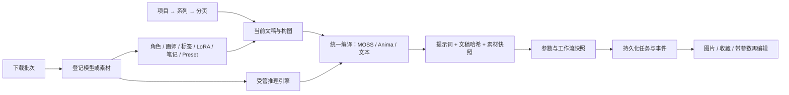

# Atelier 业务与状态约定

Atelier 把“正在编辑的内容”与“已经提交的工作”分开。页面切换改变工作区，不能改变已经开始的下载、Agent 或生成任务。项目目录仍在当前仓库，继续使用有实测基础的三种引擎启动器；创作编译、素材引用、任务快照和传输入口已按统一业务重写。

## 谁拥有哪份状态

| 内容 | 唯一来源 | 修改规则 |
|---|---|---|
| 档案、运行状态、任务 | 后端；前端通过 Query 读取 | 登记档案不自动切换或启动。 |
| 当前创作项目 | 后端 `current_project` | 前端先保存旧页，再串行切换并载入，保存失败则留在原项目。 |
| 文稿、分段、形状、引用 ID | 当前页文档 | Agent 提案带原稿版本；固定片段与版本冲突由后端再次校验。 |
| 编译结果 | `creation.compile_document` 返回的不可变副本 | 三种目标共用引用解析、记录、诊断与文稿哈希。素材后续编辑不改旧编译记录。 |
| 生成请求 | 提交时的提示词、文稿、素材、参数与渲染后工作流 | 使用编译时文稿；手改提示词后以当前稿建立新快照。哈希不符则拒绝提交。 |
| 图片与收藏 | 已完成生成记录与作品素材 | 当前创作页显示属于自己的生成结果；全局任务抽屉显示后台任务。 |
| 模型连接、密钥 | 统一提供商与 DPAPI/环境变量 | 列表不返回密钥，创作无需再维护第二套提供商。 |

## 模块接口

- `atelier/creation.py`：收拢三种编译目标、素材解析、诊断、任务记录和快照。HTTP 入口只解析请求并调用这一接口，旧 MOSS 编译入口也转交这里。
- `atelier/providers.py`：统一请求与流式事件适配；协议和本地引擎差异留在适配层。
- `atelier/generation.py`：验证绑定与来源版本，提交已渲染工作流，保存全部结果。空提示词明确沿用已绑定节点的默认值，并把实际值写入快照。
- `atelier/downloads.py`：负责批次、目录模式、磁盘检查与恢复；纯下载核心负责断点、重试、文件任务和历史。
- `atelier/store.py`、`jobs.py`：保存任务与可重放事件。重启时未完成任务转为中断，生成和工具调用不会自动重放。
- `studio/projects.ts`：所有前端项目切换共用保存、选择、载入顺序，避免异步切换写错项目。

## 服务与显存

本地引擎属于 Atelier 管理范围，ComfyUI 属于外部服务。提交出图前若受管引擎仍在运行，界面展示占用并请求明确确认；确认后仅暂停该受管引擎。出图结束后由用户手动恢复。Atelier 不停止外部 ComfyUI，也不调用会影响其他运行任务的全局中断接口。

## 验证范围

确定性测试覆盖迁移、快照、绑定、任务事件、提案冲突和服务失败。真实本机联调另记在 `docs/atelier-validation.md`，不把受控夹具当作真实模型或真实出图的证据。

## 本轮连接与工作流状态修复

Agent 创建请求携带 request_id；同会话已有运行时仅允许重订阅同一请求，其他请求返回 409。客户端断线用最后事件序号订阅原 job；刷新后查会话当前运行再重放事件，禁止重发生成请求。连接、配置与凭据只在内存中冻结给任务使用，持久化记录不写原文密钥。

工作流状态返回同一份 nodes 派生的 graph、bindings、defaults、params 与 overrides。绑定、布局、覆盖值保存请求携带 workflow_id；保存被删除工作流返回 404，不写入新选中的工作流。工作流库的读取修改保存串行执行。comfy_params 旧键仍保留以保护旧数据，界面不再把它当作全局覆盖值；快照恢复同时把参数写入新建的独立工作流。

系统文件选择仅对本机、同源请求开放；路径通过进程环境传入 WinForms，不拼接成脚本代码。取消仅终止 Atelier 自己创建的选择进程。浏览器文件上传、服务端目录浏览和手动输入仍作为不同能力保留。
